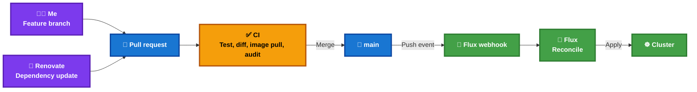
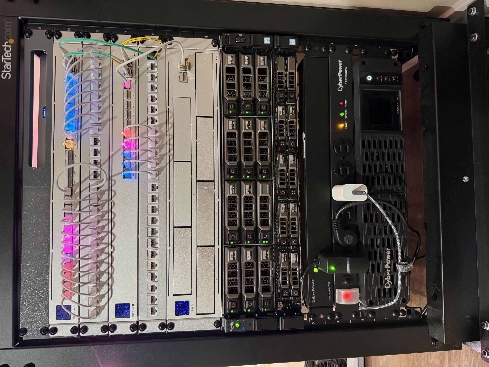
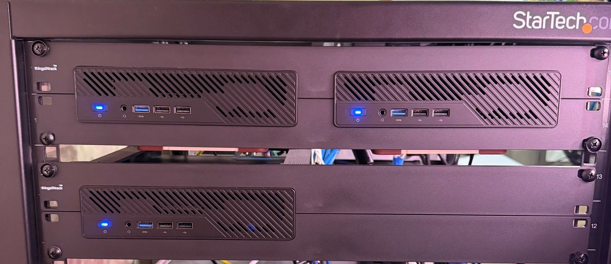

<div align="center">
  

###  My Home Operations Repository 

_... managed with Flux, Renovate, and GitHub Actions_ 

</div>

<div align="center">

[](https://status.pipitonelabs.com)&nbsp;&nbsp;
[](https://status.pipitonelabs.com)&nbsp;&nbsp;

</div>

<div align="center">

[](https://discord.gg/home-operations)&nbsp;&nbsp;
[](https://talos.dev)&nbsp;&nbsp;
[](https://kubernetes.io)&nbsp;&nbsp;
[](https://fluxcd.io)&nbsp;&nbsp;
[](https://github.com/pipitonelabs/k8s-gitops/actions/workflows/renovate.yaml)

</div>

<div align="center">

[](https://github.com/home-operations/kromgo)&nbsp;&nbsp;
[](https://github.com/home-operations/kromgo)&nbsp;&nbsp;
[](https://github.com/home-operations/kromgo)&nbsp;&nbsp;
[](https://github.com/home-operations/kromgo)&nbsp;&nbsp;
[](https://github.com/home-operations/kromgo)&nbsp;&nbsp;
[](https://github.com/home-operations/kromgo)&nbsp;&nbsp;
[](https://github.com/home-operations/kromgo)

</div>

---

##  Overview

This repository runs my homelab. Everything on the Kubernetes cluster is declared here, from the [Talos](https://www.talos.dev) machine configs to the apps, and [Flux](https://github.com/fluxcd/flux2) applies whatever lands on `main`. A merge is a deploy, so changes go through a pull request and CI first.

The cluster hosts my media stack, monitoring, and the apps I've built and self-host. It's also where I try things out, so expect it to keep changing.

---

##  Kubernetes

The cluster is three control-plane nodes and one worker, all running Talos. It's semi-hyper-converged: the nodes share their compute with [Rook](https://github.com/rook/rook)-managed Ceph block storage, each contributing one NVMe drive, and bulk data lives on a UniFi UNAS Pro over NFS.

### Core Components

| Area        | Components |
|-------------|------------|
| Networking  | [Cilium](https://github.com/cilium/cilium) for eBPF networking, [Multus](https://github.com/k8snetworkplumbingwg/multus-cni) for multi-homed pods |
| Ingress     | [Envoy Gateway](https://github.com/envoyproxy/gateway), [cloudflared](https://github.com/cloudflare/cloudflared) for public access, [Tailscale](https://github.com/tailscale/tailscale) for private access |
| Certificates and DNS | [cert-manager](https://github.com/cert-manager/cert-manager), [external-dns](https://github.com/kubernetes-sigs/external-dns) |
| Secrets     | [External Secrets](https://github.com/external-secrets/external-secrets) backed by [1Password Connect](https://github.com/1Password/connect) |
| Storage     | [Rook/Ceph](https://github.com/rook/rook), [csi-driver-nfs](https://github.com/kubernetes-csi/csi-driver-nfs), [OpenEBS](https://github.com/openebs/openebs), [Spegel](https://github.com/spegel-org/spegel) as a cluster-local image mirror |
| Data        | [CloudNativePG](https://github.com/cloudnative-pg/cloudnative-pg), [Dragonfly](https://github.com/dragonflydb/dragonfly), [Garage](https://git.deuxfleurs.fr/Deuxfleurs/garage) for S3 |
| Backups     | [VolSync](https://github.com/backube/volsync) with [Kopia](https://github.com/kopia/kopia) |
| Identity    | [Authentik](https://github.com/goauthentik/authentik) |
| Observability | [kube-prometheus-stack](https://github.com/prometheus-community/helm-charts), [Grafana](https://github.com/grafana/grafana), [VictoriaLogs](https://github.com/VictoriaMetrics/VictoriaLogs), [Gatus](https://github.com/TwiN/gatus), [kromgo](https://github.com/home-operations/kromgo) for the badges above |
| Upgrades    | [tuppr](https://github.com/home-operations/tuppr) for Talos and Kubernetes |
| Source control | [Forgejo](https://codeberg.org/forgejo/forgejo), self-hosted alongside this public GitHub repository |
| CI runners  | [actions-runner-controller](https://github.com/actions/actions-runner-controller), Forgejo runners |

### What's Running

| Namespace | Highlights |
|-----------|------------|
| `media`   | Plex, Jellyfin |
| `home`    | Atuin |
| `default` | Outline, Reactive Resume, my blog, Minecraft server |
| `database` | PostgreSQL, Dragonfly |
| `tradeforge` | TradeForge, an app I built and self-host |
| `networking` | Network Optimizer, sing-box, echo-server |

Plex and Jellyfin use Intel GPUs for hardware transcoding.

### Databases

| Database | Used for |
|----------|----------|
| `postgres17` | Shared [CloudNativePG](https://github.com/cloudnative-pg/cloudnative-pg) cluster for Authentik, Atuin, Forgejo, and Reactive Resume |
| `outline` | Dedicated PostgreSQL cluster for Outline |
| `tradeforge-pg` | Dedicated PostgreSQL cluster for TradeForge, which reaches it through PostgREST and Supabase Realtime |
| [Dragonfly](https://github.com/dragonflydb/dragonfly) | Redis-compatible cache for Authentik and Outline |

### GitOps

[Flux](https://github.com/fluxcd/flux2) watches the [kubernetes](./kubernetes) folder. Each namespace under [kubernetes/apps](./kubernetes/apps) has a `kustomization.yaml` pointing at its apps, and each app has a Flux `Kustomization` (`ks.yaml`) that deploys its `HelmRelease` and related resources. Shared patterns such as backups and databases live in [kubernetes/components](./kubernetes/components), so a new app can pull them in with a line or two.



Flux also deploys in dependency order. Each `Kustomization` declares what it needs with `dependsOn`, so an app like Plex waits until its storage is ready:


[Renovate](https://github.com/renovatebot/renovate) watches the whole repository and opens a PR for each update. Only a short list of trusted updates merges automatically, and those wait three days after release first.

Every PR is checked by [CI](./.github/workflows/ci.yaml) before merging:

- [flate](https://github.com/home-operations/flate) tests the rendered manifests.
- A diff of what will change in the cluster is posted to the PR.
- New images are pre-pulled to a node, so a bad tag fails before it's deployed.
- [zizmor](https://github.com/zizmorcore/zizmor) audits the GitHub Actions workflows.

### Backups

- **Volumes**: VolSync snapshots app PVCs hourly into a Kopia repository on the UNAS.
- **Databases**: CloudNativePG backs up through the Barman Cloud plugin.
- **etcd**: A CronJob takes a nightly snapshot.
- **Offsite**: A nightly job copies the Kopia repository and Garage data to offsite S3 storage, encrypted.

### Directories

```sh
📁 bootstrap       # Helmfile stages that bring up a new cluster
📁 docs            # Rebuild runbooks and notes
📁 kubernetes      # Kubernetes cluster defined as code
├─📁 apps          # Apps deployed into my cluster, grouped by namespace
├─📁 components    # Re-usable kustomize components
└─📁 flux          # Flux system configuration
📁 talos           # Layered Minijinja templates for Talos machine configs
```

Automation lives in [just](https://just.systems) recipes. `just bootstrap cluster` brings the cluster up from scratch, and [docs/rebuild-cluster.md](./docs/rebuild-cluster.md) has the full runbook.

---

##  Networking

Everything runs on UniFi. A UCG Fiber handles routing and firewalling, with 5 Gbps Frontier Fiber as the primary WAN and Starlink as automatic failover. It connects at 10G to the USW Pro Max 24 PoE, which serves the Kubernetes nodes over bonded 2.5G links plus the cameras and IoT gear. The USW Pro XG 10 PoE hangs off that switch at 10G and carries the storage, workstations, and access points.

Cilium advertises `LoadBalancer` IPs from the `services` VLAN to the UCG Fiber over BGP.

<div align="center">
  
</div>

---

##  DNS

Two instances of [ExternalDNS](https://github.com/kubernetes-sigs/external-dns) handle DNS, and the gateway a route uses decides where its records go:

| Gateway          | Syncs to | Used for |
|------------------|----------|----------|
| `envoy-internal` | My UCG Fiber, via the [UniFi webhook provider](https://github.com/kashalls/external-dns-unifi-webhook) | Private services |
| `envoy-external` | Cloudflare | Public services |

---

##  Hardware

<details>
  <summary>Click to see my rack</summary>

  
  
</details>

---

| Device                      | Count | OS Disk Size  | Data Disk Size     | Ram   | Operating System | Purpose             |
|-----------------------------|-------|---------------|--------------------|-------|------------------|---------------------|
| MS-01 (i9-12900H)           | 3     | 1xTB m2 nvme  | 1xTB m2 nvme       | 64GB  | Talos            | Kubernetes          |
| GMKtec M5 Plus              | 1     | 256GB m2 nvme | 1xTB m2 nvme       | 32GB  | Talos            | Kubernetes          |
| Dell R730XD                 | 1     | -             | Random drive sizes | 128GB | UnRAID OS        | NFS                 |
| superheavy (UniFi UNAS Pro) | 1     | -             | 7x16TB HDD         | 8GB   | UniFi OS         | NFS and backups     |
| UniFi UCG Fiber             | 1     | -             | 1x2TB m2 nvme      | -     | UniFi OS         | Router & NVR        |
| UniFi USW Pro Max 24 PoE    | 1     | -             | -                  | -     | UniFi OS         | 1/2.5Gb PoE Switch  |
| UniFi USW Pro XG 10 PoE     | 1     | -             | -                  | -     | UniFi OS         | 10Gb PoE Switch     |

---

##  Gratitude and Thanks

Many thanks to all the fantastic people who donate their time to the [Home Operations](https://discord.gg/home-operations) Discord community. Be sure to check out [kubesearch.dev](https://kubesearch.dev) for ideas on how to deploy applications or get ideas on what you may deploy.

---

##  License

See [LICENSE](./LICENSE).
