# Networking

## Addresses

| Purpose | Value |
|---|---|
| Nodes | `192.168.10.0/24` |
| LoadBalancer services | `192.168.20.0/24` |
| Kubernetes API | `k8s.internal`, `192.168.20.2:6443` |
| External gateway | `192.168.20.80` |
| Internal gateway | `192.168.20.81` |
| Pods | `10.244.0.0/16` |
| Kubernetes services | `10.245.0.0/16` |

## Node links

Every node bonds two NICs into `bond0` with LACP and gets its address by DHCP on the bond.

| Setting | `m0`, `m1`, `m2` | `w2` |
|---|---|---|
| Members | `enp2s0f0np0`, `enp2s0f1np1` | `net0`, `net1` (link aliases) |
| Driver | `i40e` | `r8169` |
| LACP rate | Fast | Slow |
| Bond MTU | 9000 | 9000 |
| MTU of VLANs 20, 30, 70 | 1500 | 1500 |

The 2.5G ports on the MS-01 nodes are unused. Bond members cannot be changed on a running bond: stage the
config and reboot.

VLAN 70 is bridged as `br70`. The Multus network `networking/multus-servers` puts VMs on it.

## BGP

Cilium advertises LoadBalancer addresses to the router.

| Side | ASN | Address |
|---|---|---|
| Cilium, on every node | `64514` | `192.168.10.10`, `.11`, `.12`, `.15` |
| UniFi router | `64513` | `10.69.1.1` |

The router's side is [bgp-config.conf](bgp-config.conf). A new node needs a neighbor entry there.

## Gateways and DNS

The gateway on an app's route decides where its DNS record is created.

| Gateway | DNS | Reachable from |
|---|---|---|
| `envoy-internal` | UniFi | Home network and Tailscale |
| `envoy-external` | Cloudflare | Internet |

Use `envoy-internal` unless the app has to be public.

## Certificates

cert-manager issues the wildcard certificate with Let's Encrypt. `certificates-export` saves it to the secret
store, and the bootstrap and `certificates-import` restore it, so a rebuild does not hit rate limits.

## Kubernetes API address

A Talos layer 2 VIP and the Cilium `kube-vip` Service both use `192.168.20.2`. During bootstrap the kubeconfig
points at a node IP, because the shared address is not dependable until Cilium runs.
